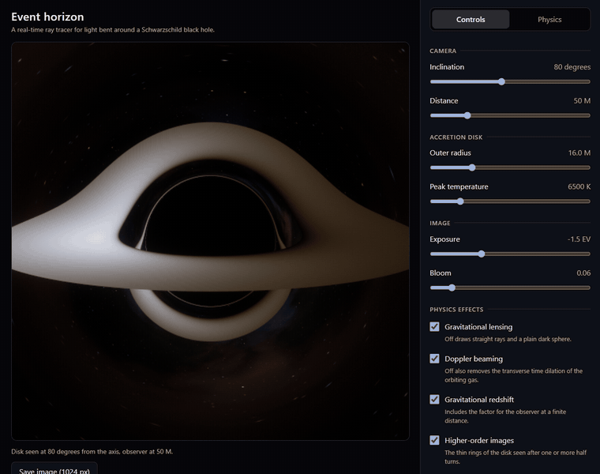
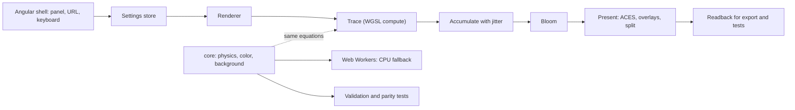

# Event horizon

A WebGPU ray tracer running in real time that depicts a Schwarzschild black hole. It includes bent light, the photon ring and an accretion disk with Doppler beaming and gravitational redshift, and switches that show what each effect contributes.



Live demo: https://eventhorizon.adrianturbinski.pl/ (needs a browser with WebGPU, otherwise it falls back to a slower CPU render in Web Workers).

[](https://github.com/adiyy2001/eventhorizon/actions/workflows/ci.yml)

[](LICENSE)

## Why I built this

My day job involves writing software that generates single-line diagrams of high-voltage electrical substations: Angular and diagram rendering on the frontend, Java 21 and Quarkus on the backend. This project is a deliberate change of scale from that: one scene, one equation and a result I can verify against a textbook.

It's also a self-contained exercise in three things I wanted to do end to end: numerical integration, GPU programming and color science. Every pixel has to line up with general relativity, which makes the result easy to verify and hard to fake. That is why it has a float64 reference integrator shared by the tests, the parity runs and the fallback.

## What's hard about it

### Float32 near the photon sphere

A ray with an impact parameter near the critical value spirals around the hole and exits in a direction that depends on the last digits of its initial conditions. Since the shader uses float32 math, it cannot agree with float64 there. The parity set leaves out rays within 0.02 of the critical value and says so. For everything else I verify the GPU output against the float64 reference and against a `Math.fround` copy of the shader running on the CPU, which shows that the remaining error is rounding and not a bug in the port.

### One sign decides which side of the disk is bright

The tracer runs backwards from the camera, so the photon travels along minus the traced tangent. Getting the sign of the photon's angular momentum wrong just flips the bright and dim sides and still looks convincing. The sign is covered by hand-computed unit tests and a physical test: on a tilted view, the side moving towards the camera must come out brighter and bluer (`docs/physics.md`, section 9).

### A step size that is accurate and cheap

Fixed steps either waste work far from the hole or miss the ring near it. The step size scales with the radius and shrinks where the ray bends quickly. I swept the constants against the capture boundary and the deflection angle, and picked the row that keeps the shadow edge more than three orders of magnitude inside the 1e-4 target at about 108 steps per ray (`pnpm validate:steps`).

### Stars under strong lensing

Stars baked into a cubemap blur when lensing magnifies them. Instead, stars are evaluated per ray at the ray's final direction, so a star near the ring is smeared into an arc once the sub-pixel jitter accumulates. One bug turned up on the way: hardware cube filtering returned only half the value within a thousandth of a radian of a face edge, which drew faint dark hairlines across the preview video. The nebula is now baked with a one texel border and sampled as a 2D array layer (ADR 12).

### No WebGPU

The same float64 integrator runs in a pool of Web Workers, stepping through coarse-to-fine passes, and the main thread applies the same bloom, tone map and dither as the GPU path. A test compares the two pictures (worst mean difference 0.017 of 255), so the fallback is a correctness check on the shader as well as a plan B.

## How it works



`src/core` is plain TypeScript with no DOM and no Angular. The GPU code, the workers, the tests and the benchmarks all import the same physics from it.

Units are $G = c = M = 1$, so the Schwarzschild radius is $r_s = 2$. A light ray stays in the plane of its position and direction. In vector form, with $h = |\mathbf{x}\times\mathbf{x}'|$ constant along the ray, the equation the tracer integrates with RK4 is

$$\mathbf{x}'' = -\frac{3}{2}\,r_s\,h^2\,\frac{\mathbf{x}}{|\mathbf{x}|^5}.$$

It is equivalent to the Binet form $u'' + u = 3Mu^2$ with $u = 1/r$, and a test checks that the two give the same deflection. Rays start in the orthonormal frame of a static observer, so the picture stays right close to the hole. The shadow edge sits at the critical impact parameter $b_c = 3\sqrt{3}\,M \approx 5.196\,M$.

The disk is thin, lies in the equatorial plane, starts at the ISCO ($r = 6M$) and has $T(r) \propto r^{-3/4}\,(1 - \sqrt{r_\text{in}/r})^{1/4}$. Emitters move on circular orbits with $\Omega = \sqrt{M/r^3}$. One factor covers gravitational redshift, Doppler shift and time dilation:

$$g = \frac{\sqrt{1 - 3M/r}}{1 - \Omega\lambda}$$

where $\lambda$ is the photon's angular momentum about the disk axis per unit energy. A blackbody seen through $g$ is again a blackbody, at temperature $gT$, and its bolometric intensity scales with $g^4$. The temperature goes through a lookup table built by integrating the Planck spectrum against the CIE 1931 color matching functions, then to linear sRGB, bloom, the ACES filmic fit and exposure.

`docs/physics.md` derives every equation with its sources and names the test that checks it.

## Validation and benchmarks

Every number below comes from a script in the repository and was produced on 2026-10-10. Each result file in `bench/results/` prints the hardware and the browser it ran on.

Hardware: the CPU and software runs used an Intel Core i7-12700H (20 logical cores) under WSL2 with Chromium 153, and the software WebGPU adapter was SwiftShader. The hardware GPU runs used the same laptop with Chrome 154 on Windows, which has an NVIDIA GeForce RTX 3070 Ti Laptop GPU and an Intel Iris Xe. The result files record the adapters as `nvidia ampere` and `intel gen-12lp`, and the model names come from the laptop's specification. The machine was busy with other work during the CPU runs, and the result files record the load average where it matters.

### Physics (`pnpm validate:physics`, float64 reference)

| Check                                                                  | Result                       | Limit                   |
| ---------------------------------------------------------------------- | ---------------------------- | ----------------------- |
| Critical impact parameter by bisection, observer at D = 10, 30, 100    | error 3.7e-8, 5.2e-8, 5.3e-8 | 1e-6                    |
| Binet form against the vector form (Dormand-Prince), b from 5.3 to 500 | 4.7e-12 rad                  | 1e-9                    |
| Exact deflection by elliptic integrals against quadrature              | 6.2e-15 rad                  | 1e-10                   |
| Production RK4 tracer against the Binet form                           | 5.2e-7 rad                   | 2e-6                    |
| Weak field: leading term 4M/b, relative error at b = 400               | 7.4e-3 (shrinks as 1/b)      | below the b = 200 value |
| Third order series against the exact deflection at b = 100             | 1.8e-6 rad                   | 5e-6                    |
| Relative drift of h over 16384 rays                                    | 4.3e-10                      | 1e-8                    |
| Null condition drift over the same rays                                | 6.1e-8                       | 1e-6                    |
| Redshift at the ISCO for lambda = 0 (should be sqrt(1/2))              | error 7.1e-13                | 1e-9                    |

The reference traced 13597 rays per second on one core of the CPU above (the machine was busy), 107.7 steps per ray on average over a 128 by 128 view.

### GPU against the float64 reference (`pnpm bench:parity`)

4096 rays plus a 128 by 128 image at the default view. All three adapters give the same outcome (captured, escaped or hit the disk) on every ray and every pixel, and every final direction is within the 1e-3 rad tolerance.

| Adapter                                     | Outcomes equal | Direction, max | Hit radius, max relative |
| ------------------------------------------- | -------------- | -------------- | ------------------------ |
| RTX 3070 Ti Laptop GPU (Chrome 154)         | 4096 of 4096   | 1.5e-4 rad     | 8.1e-5                   |
| Intel Iris Xe (Chrome 154)                  | 4096 of 4096   | 1.6e-4 rad     | 1.5e-4                   |
| SwiftShader software adapter (Chromium 153) | 4096 of 4096   | 1.6e-4 rad     | 1.4e-4                   |

The GPU parity run for the hardware adapters is `bench/windows/bundle-parity.mjs` plus `bench/gpu-parity.ts` with `EVENTHORIZON_HARDWARE_GPU=1`, `EVENTHORIZON_CHROME` and `EVENTHORIZON_ORIGIN` set. The software run is plain `pnpm bench:parity`.

### Frame times at 1920 by 1080 (`bench/results/frame-times-*.json`)

GPU time per frame from timestamp queries, median over 120 moving frames of a scripted camera orbit.

| Adapter                | Dynamic resolution    | GPU time per frame | Frames per second at the median interval |
| ---------------------- | --------------------- | ------------------ | ---------------------------------------- |
| RTX 3070 Ti Laptop GPU | off                   | 12.1 ms            | 66                                       |
| RTX 3070 Ti Laptop GPU | on (stays at scale 1) | 12.1 ms            | 67                                       |
| Intel Iris Xe          | off                   | 136.6 ms           | 7                                        |
| Intel Iris Xe          | on (scale 0.35)       | 17.7 ms            | 62                                       |

The targets were 60 frames per second at 1080p on a mid-range discrete GPU and 30 on an integrated one with dynamic resolution. Both are met on this laptop. A still picture refines at full resolution once the camera stops. The workgroup shape was measured on the RTX: 4 by 4 took 23.9 ms, 8 by 8 took 12.2 ms and 16 by 16 took 12.4 ms, so the shader uses 8 by 8. On SwiftShader a full 1080p frame takes 14.6 s, which only shows that the script runs.

### Fallback without WebGPU (`pnpm bench:fallback`)

512 by 512, plain Chromium without WebGPU flags, median of five loads, on the i7-12700H with the load average between 9 and 18 during the run.

| Workers | First image | Full image | First image after a camera change | Full image after a camera change |
| ------- | ----------- | ---------- | --------------------------------- | -------------------------------- |
| 1       | 781 ms      | 13.0 s     | 235 ms                            | 15.8 s                           |
| 4       | 408 ms      | 3.1 s      | 62 ms                             | 2.7 s                            |
| 8       | 558 ms      | 2.6 s      | 58 ms                             | 2.0 s                            |

Software picture against graphics picture over nine scenarios (`pnpm bench:cpu-gpu`): worst mean absolute difference 0.017 of 255, largest single pixel difference 1, tolerance 0.25.

### Lighthouse (`pnpm lighthouse`)

Accessibility 1, best practices 1 and SEO 1 for the production build in both renderers on mobile and desktop. Performance came out between 0.75 and 0.96 in the last run. That run used the software adapter and a busy machine, so the performance score says little about real hardware.

## Run it locally

You need Node 24.15 or newer and pnpm 11 (`corepack enable` gives you the pinned version).

```sh
git clone https://github.com/adiyy2001/eventhorizon.git && cd eventhorizon
pnpm install
pnpm start
```

Open http://127.0.0.1:4200. Everything the app needs is in the build, including the KaTeX fonts. The address holds the whole state, so a link reproduces a view.

Keys: arrows orbit and tilt, plus and minus change the distance, Home resets, `?` opens the help.

## Tests

`pnpm verify` runs what CI runs: format check, lint, the style check (no comments, no dashes, one repository owner in every link), type check, unit tests with coverage and a check that the coverage figure in this README matches the run, the physics validation, a production build, the Playwright suite, the GPU against float64 parity run and Lighthouse.

- Unit tests (797 in the app, 97 for the scripts): physics, color, background, settings, URL codec, keyboard map, the CPU renderer, dynamic resolution, accumulation, uniform packing. Line coverage is 98.8 percent overall. Core logic must reach 90 percent and the rest 80 percent, enforced per directory. Files that only call WebGPU entry points are on one explicit list, and a test fails if a file outside it touches the device.
- End to end (89 Playwright specs against the production build): one test per must-have, the GPU against CPU parity on SwiftShader, ten visual baselines in `e2e/baselines` compared by mean and by largest channel difference, the keyboard, the address, the physics panel with every equation, accessibility, 20 renderer create and destroy cycles on one device, and the whole no-WebGPU path in a browser launched without the flags.
- `pnpm test:visual` runs only the baselines, and `pnpm capture:baselines` writes new ones after a deliberate change.

The baselines were rendered on SwiftShader and have not been compared on a hardware GPU.

## Design decisions

The ADRs in `docs/adr` record the non-obvious choices.

1. [Angular shell around a framework-free core](docs/adr/0001-angular-shell-with-framework-free-core.md)
2. [Geodesic equation form and integrator](docs/adr/0002-geodesic-equation-form-and-integrator.md)
3. [Color matching functions from an analytic fit](docs/adr/0003-color-matching-functions-analytic-fit.md)
4. [Vitest for unit tests, Playwright for the browser](docs/adr/0004-test-stack-vitest-and-playwright.md)
5. [Rendering architecture](docs/adr/0005-rendering-architecture.md)
6. [Toolchain versions and pins](docs/adr/0006-toolchain-versions-and-pins.md)
7. [Disk model, redshift factor and what the switches mean](docs/adr/0007-disk-model-and-redshift-factor.md)
8. [Tone mapping with the ACES fit by Stephen Hill](docs/adr/0008-tone-mapping-aces-hill-fit.md)
9. [Coverage policy](docs/adr/0009-coverage-policy.md)
10. [Fallback renderer in Web Workers](docs/adr/0010-fallback-renderer-in-web-workers.md)
11. [Frames for tests, exports and media come from GPU readback](docs/adr/0011-frame-capture-by-gpu-readback.md)
12. [Background, radiance scale and HDR chain](docs/adr/0012-background-and-hdr-chain-decisions.md)
13. [Interactive renderer](docs/adr/0013-interactive-renderer-decisions.md)
14. [Interface state, address and accessibility](docs/adr/0014-interface-state-and-accessibility.md)
15. [Hardening decisions](docs/adr/0015-hardening-decisions.md)
16. [Hardware GPU runs and the demo recording](docs/adr/0016-hardware-gpu-runs-and-demo-recording.md)
17. [Stretch goals left out](docs/adr/0017-stretch-goals-left-out.md)

## Limitations and what I would do next

- The disk is thin and opaque, emits isotropically and has no limb darkening, no relativistic correction factor from Page and Thorne, and no light that returns to the disk. `docs/physics.md` section 10 lists the simplifications. Thick disks, jets and magnetohydrodynamics are out of scope.
- Rays within 0.02 of the critical impact parameter are left out of the GPU parity set, because float32 cannot agree with float64 there. The shadow edge itself is checked on the CPU.
- The ACES fit pushes very hot regions toward white and can shift their hue. The defaults (6500 K at -1.5 EV) keep the gradient and the beamed side visible. AgX would handle this better, but its reference carries no license.
- The fallback picture is fixed at 512 by 512 with one ray per pixel and no accumulation. The photon sphere and ISCO overlays need the graphics path, so their switches are disabled without WebGPU.
- Hardware numbers come from one laptop. The integrated GPU needs the floor of the dynamic resolution controller (scale 0.35) to reach 60 frames per second. I have not run it on other GPUs, on Firefox or on Safari.
- The visual baselines come from SwiftShader. A hardware GPU can differ in the last bits.
- I did not build a Kerr black hole or a free-falling observer with aberration. Both were optional, and each needs its own equations, parity run and ADR (ADR 17). Kerr would be next, as a separate mode.
- Next after that: run the Playwright baselines on a hardware GPU in CI, and re-record the demo and the fallback video on other adapters.

## Credits and license

Third-party code, data and constants are listed with their licenses in [CREDITS.md](CREDITS.md). Nothing is vendored. MIT, see [LICENSE](LICENSE).
